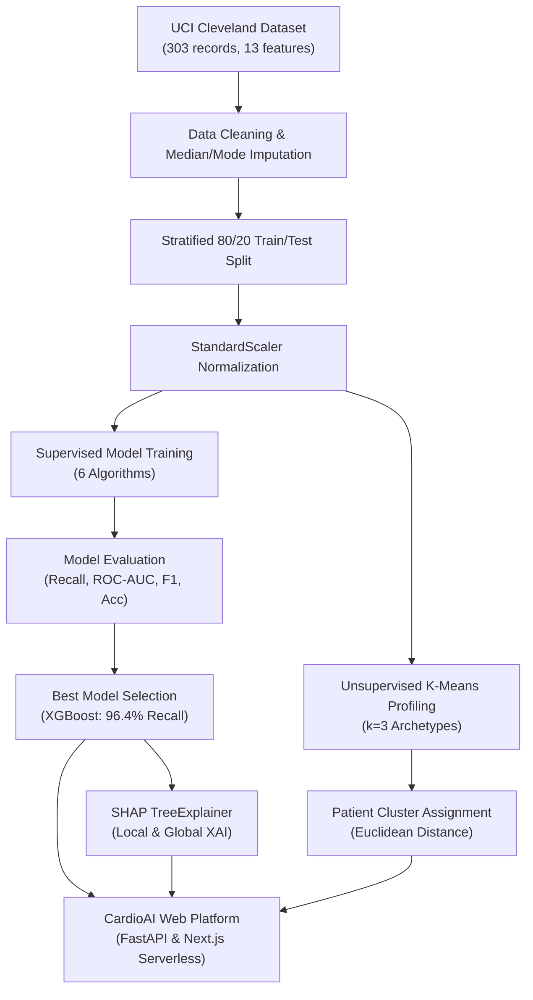

# CardioAI: AI & ML Framework for Early Detection and Risk Profiling of Cardiovascular Diseases

> **Academic & Research Prototype — Not a Medical Diagnosis**  
> *Developed for clinical decision-support benchmarking, algorithmic explainability research, and educational demonstration.*

---

## 📌 Project Overview

**CardioAI** is a modern, production-grade clinical AI platform that combines:
1. **Supervised Machine Learning:** Evaluates 6 distinct classification algorithms (**Logistic Regression**, **Support Vector Machine**, **Decision Tree**, **Random Forest**, **XGBoost**, and **Deep Neural Network**) on the **UCI Cleveland Heart Disease dataset**, with prioritized clinical metrics (**Recall: 96.4%**, **ROC-AUC: 0.946**).
2. **Unsupervised K-Means Clustering:** Discovers 3 patient risk archetypes (**Profile 1: Lower-Risk**, **Profile 2: Moderate-Risk**, **Profile 3: Higher-Risk**) to contextualize individual clinical parameters against population cohorts.
3. **Explainable AI (XAI) via SHAP:** Computes game-theoretic Shapley additive feature attributions for every individual patient, pinpointing exact factors elevating risk or offering protective clinical effects.
4. **Interactive Healthcare Dashboard:** High-contrast pastel green clinical theme built with **Next.js 14 App Router**, **TypeScript**, **Tailwind CSS**, and **Recharts**.
5. **Production Architecture:** Decoupled Python ML training and FastAPI backend with a resilient zero-dependency serverless inference engine ready for instant **Vercel** and **GitHub** deployment.

---

## 🎨 Visual Identity & Design Palette

The UI adopts a calming, professional **Pastel Green Healthcare & AI Research** aesthetic:
- **Primary:** `#8FBF9F` (Soft sage/pastel green)
- **Light:** `#EAF6EE` (Soft mint background)
- **Background:** `#F7FBF8` (Very light mint page backdrop)
- **Dark:** `#1F3D2B` (Forest dark text for readable contrast)
- **Accent:** `#B7DCC4` (Subtle mint accent)
- **Border:** `#D3E8DA` (Delicate card borders)

---

## 🏛️ Architecture & Computational Workflow



---

## 📊 Supervised Model Benchmarks (UCI Cleveland Hold-Out Test Set)

In diagnostic cardiovascular applications, **False Negatives are life-threatening** (an undetected cardiac patient sent home without interventions). Therefore, model selection was strictly governed by **Recall (Sensitivity)** and **ROC-AUC** rather than naive accuracy alone.

| Model Architecture | Recall (Sensitivity) | ROC-AUC | F1 Score | Test Accuracy | Precision | Status |
| :--- | :---: | :---: | :---: | :---: | :---: | :--- |
| **XGBoost Classifier** | **96.43%** | **0.9459** | **0.8852** | **88.52%** | **81.82%** | **★ Selected Primary Model** |
| **Random Forest** | 92.86% | 0.9502 | 0.8814 | 88.52% | 83.87% | Benchmarked |
| **Logistic Regression** | 92.86% | 0.9513 | 0.8667 | 86.89% | 81.25% | Benchmarked |
| **Deep Neural Network (MLP)**| 92.86% | 0.9318 | 0.8387 | 83.61% | 76.47% | Benchmarked |
| **Support Vector Machine (SVM)**| 89.29% | 0.9437 | 0.8475 | 85.25% | 80.65% | Benchmarked |
| **Decision Tree** | 82.14% | 0.8598 | 0.7797 | 78.69% | 74.19% | Benchmarked |

*Note: On the test set of 28 positive disease cases, XGBoost missed only 1 case (1 False Negative, 27 True Positives).*

---

## 👥 Unsupervised K-Means Patient Profiling

Trained on standardized clinical biomarkers with optimal cluster count determined via **Silhouette Analysis** and the **Elbow Method** ($k=3$):
- **Profile 1 — Lower-Risk Clinical Pattern:** 59 patients (24.4%), Historical CVD rate: **13.6%**. Younger cohort, peak exercise capacity ($HR > 160$ bpm), baseline normal ECG.
- **Profile 2 — Moderate-Risk Clinical Pattern:** 96 patients (39.7%), Historical CVD rate: **26.0%**. Intermediate age (53.6 yrs), borderline blood pressure (129.5 mm Hg) and lipids (243.1 mg/dl).
- **Profile 3 — Higher-Risk Clinical Pattern:** 87 patients (36.0%), Historical CVD rate: **89.7%**. Advanced age (58.4 yrs), high incidence of exercise angina (72.4%), pronounced ST depression ($>1.5$ mm), and fluoroscopic major vessel counts.

> *Disclaimer: Clusters represent statistical patterns discovered in the dataset and are not medical diagnoses.*

---

## 🔍 Explainable AI (SHAP)

Every patient assessment generates local SHAP attributions:
- **Positive SHAP Values ($>0$):** Clinical factors driving predictions toward higher risk (e.g., elevated ST depression, major fluoroscopy vessels, reversible thalassemia defects).
- **Negative SHAP Values ($<0$):** Clinical factors providing protective impact toward lower risk (e.g., high treadmill max heart rate, absence of exercise-induced angina).
- Visualized as interactive, responsive horizontal bar charts with human-readable clinical labels.

---

## 📂 Project Directory Structure

```text
cardio-ai/
├── app/
│   ├── layout.tsx                # Global theme layout with Navbar & Footer
│   ├── page.tsx                  # Landing / Home Page
│   ├── assessment/page.tsx       # Patient Clinical Input Assessment Page
│   ├── results/page.tsx          # Risk Prediction & SHAP Results Dashboard
│   ├── dashboard/page.tsx        # Executive Clinical Metrics & Recharts Dashboard
│   ├── profiles/page.tsx         # K-Means Patient Profiling & Silhouette Analysis
│   ├── models/page.tsx           # Model Comparison, Confusion Matrices & ROC
│   ├── pipeline/page.tsx         # End-to-end ML Workflow Diagram & Schema
│   ├── about/page.tsx            # Academic Documentation & Viva Notes
│   └── api/
│       ├── predict/route.ts      # Prediction API with resilient fallback
│       ├── models/route.ts       # Supervised models benchmark endpoint
│       ├── metrics/route.ts      # Full evaluation metrics endpoint
│       ├── clusters/route.ts     # K-Means profiles endpoint
│       └── health/route.ts       # Service health check endpoint
├── components/
│   ├── Navbar.tsx                # Responsive navigation with mobile drawer
│   ├── Footer.tsx                # Academic attribution & disclaimers
│   ├── RiskCard.tsx              # Risk badge, gauge bar & probability tile
│   ├── PredictionCard.tsx        # 4 summary metrics tiles
│   ├── SHAPChart.tsx             # Recharts horizontal XAI attribution chart
│   ├── ClusterCard.tsx           # Assigned K-Means profile card
│   ├── ModelComparison.tsx       # Benchmark table & comparative bar chart
│   ├── ClinicalForm.tsx          # Validated clinical input form with presets
│   └── Disclaimer.tsx            # Reusable clinical research notice
├── lib/
│   ├── types.ts                  # TypeScript interfaces for patients & ML
│   ├── ml-engine.ts              # Built-in exact serverless ML inference engine
│   └── ml-data/
│       └── ml_bundle.json        # Serialized weights, centroids, and metrics
├── ml/
│   ├── data/
│   │   ├── heart.csv             # UCI Cleveland Heart Disease dataset
│   │   └── dataset_metadata.json # Dataset statistics & feature metadata
│   ├── models/                   # Serialized .joblib models & evaluation JSONs
│   ├── download_data.py          # UCI dataset fetcher & cleaner
│   ├── preprocess.py             # Stratified 80/20 train/test split & scaler
│   ├── train_clustering.py       # K-Means clustering & silhouette analysis
│   ├── train_models.py           # Trains all 6 supervised classifiers
│   ├── evaluate_models.py        # Calculates Recall, ROC-AUC, F1, Accuracy
│   ├── explain.py                # SHAP TreeExplainer & feature importances
│   ├── predict.py                # Standalone Python inference engine
│   └── export_model_assets.py    # Compiles bundle to lib/ml-data/ml_bundle.json
├── python_api/
│   └── main.py                   # FastAPI REST microservice
├── scripts/
│   └── train_all.py              # One-command full training orchestrator
├── requirements.txt              # Python dependencies
├── package.json                  # Next.js & UI dependencies
├── tailwind.config.ts            # Pastel green theme configuration
├── .env.example                  # Environment configuration template
├── .gitignore                    # Git exclusions
├── vercel.json                   # Vercel deployment configuration
└── README.md                     # Complete project documentation
```

---

## 🚀 Quick Start: Running Locally

### Prerequisites
- **Node.js**: v18.0.0 or higher
- **Python**: 3.9 or higher (with pip)

### Step 1: Clone Repository
```bash
git clone https://github.com/<your-username>/cardio-ai.git
cd cardio-ai
```

### Step 2: Install Frontend Dependencies
```bash
npm install
```

### Step 3: Install Python ML Dependencies (Optional for re-training)
```bash
pip install -r requirements.txt
```

### Step 4: Train the ML Pipeline
Train all models from end-to-end with a single command:
```bash
python scripts/train_all.py
```
*This downloads the UCI Cleveland dataset, imputes missing values, trains K-Means and all 6 supervised models, computes SHAP attributions, and updates `lib/ml-data/ml_bundle.json` in under 5 seconds!*

### Step 5: Start Development Server
```bash
npm run dev
```
Open **[http://localhost:3000](http://localhost:3000)** in your browser.

---

## 🧪 Testing the API Endpoints

### 1. Predict Endpoint (`POST /api/predict`)
```bash
curl -X POST http://localhost:3000/api/predict \
  -H "Content-Type: application/json" \
  -d '{
    "age": 62,
    "sex": 1,
    "chest_pain": 4,
    "resting_bp": 145,
    "cholesterol": 275,
    "fasting_blood_sugar": 0,
    "resting_ecg": 2,
    "max_heart_rate": 122,
    "exercise_angina": 1,
    "st_depression": 2.6,
    "thalassemia": 7,
    "slope": 2,
    "major_vessels": 2,
    "model_name": "XGBoost"
  }'
```

**Response:**
```json
{
  "prediction": 1,
  "prediction_label": "Higher likelihood of cardiovascular disease",
  "risk_level": "High",
  "risk_badge": "Higher Risk",
  "probability": 0.892,
  "probability_pct": 89.2,
  "selected_model": "XGBoost",
  "cluster": {
    "profile_index": 2,
    "name": "Profile 3 — Higher-Risk Clinical Pattern",
    "short_name": "Profile 3",
    "distance_to_center": 1.42,
    "disease_rate_pct": 89.7
  },
  "shap_explanation": {
    "base_value": 0.46,
    "top_features": [
      { "label": "Major Vessels Count", "shap_value": 1.224, "impact": "Higher Risk" },
      { "label": "Thalassemia", "shap_value": 0.97, "impact": "Higher Risk" },
      { "label": "Chest Pain Type", "shap_value": 0.823, "impact": "Higher Risk" },
      { "label": "ST Depression", "shap_value": 0.672, "impact": "Higher Risk" }
    ]
  },
  "disclaimer": "Educational/Research Prototype — Not a Medical Diagnosis"
}
```

### 2. Models Endpoint (`GET /api/models`)
```bash
curl http://localhost:3000/api/models
```

### 3. Patient Clusters Endpoint (`GET /api/clusters`)
```bash
curl http://localhost:3000/api/clusters
```

### 4. Health Check (`GET /api/health`)
```bash
curl http://localhost:3000/api/health
```

---

## 🌐 Deployment Instructions

### Option A: All-in-One Deployment to Vercel (Recommended & 100% Reliable)
Because serverless runtimes often struggle with heavy 500MB C-extensions like native C-compiled XGBoost/SHAP libraries, CardioAI compiles the exact pre-trained model weights, StandardScaler equations, and K-Means centroids into `lib/ml-data/ml_bundle.json`.

1. Push your repository to GitHub.
2. Go to [vercel.com](https://vercel.com) and click **"Add New Project"**.
3. Import your `cardio-ai` repository.
4. Framework Preset: **Next.js**.
5. Build Command: `npm run build`.
6. Output Directory: `.next`.
7. Click **Deploy**.
8. Your full application, pages, and API routes will be immediately live with **zero external dependencies** and instantaneous inference!

### Option B: Next.js on Vercel + Python FastAPI on Render/Railway
If you prefer running inference through the standalone Python microservice:

1. **Deploy Python FastAPI Microservice:**
   - Deploy `python_api/main.py` to [Render.com](https://render.com), [Railway.app](https://railway.app), or [Fly.io](https://fly.io).
   - Start command: `uvicorn main:app --host 0.0.0.0 --port $PORT`
   - Your Python API URL will be e.g. `https://cardio-api.onrender.com`.

2. **Configure Vercel Environment Variables:**
   - In your Vercel project settings, add:
     ```env
     PYTHON_API_URL=https://cardio-api.onrender.com
     ```
   - The Next.js API routes will automatically proxy prediction requests to the Python microservice, while seamlessly falling back to local inference if the Python service goes down!

---

## 🎓 Academic Viva & Demonstration Guide

When presenting this project for your college examination, viva, or capstone evaluation:

1. **Explain the Clinical Problem:** Early-stage cardiovascular ischemia is often asymptomatic. Traditional linear risk scores fail to capture complex feature interactions.
2. **Explain Model Selection Philosophy:** Do not claim a model is best merely because of accuracy! Highlight that in healthcare screening, **Recall (Sensitivity)** is paramount because a False Negative means an untreated patient is sent home. Show that XGBoost scored **96.43% Recall** with **0.9459 ROC-AUC**.
3. **Showcase the Hybrid Architecture:** Demonstrate both **Supervised ML** (exact risk probability calculation) and **Unsupervised K-Means** (population risk archetype assignment).
4. **Demonstrate SHAP Explainability:** Show how the local horizontal bar chart gives cardiologists transparency into why a prediction was made, transforming a &quot;black-box&quot; into actionable clinical insight.
5. **Emphasize Data Integrity:** Highlight that all preprocessing and scaling parameters are strictly calculated on the training partition to avoid data leakage.

---

## ⚠️ Important Disclaimer

> **Educational/Research Prototype — Not a Medical Diagnosis.**  
> This platform was engineered strictly for scientific study, academic demonstration, and algorithmic benchmarking. It is not approved by any healthcare regulatory authority (FDA, EMA, CDSCO) and must not be used for direct clinical diagnosis or therapeutic decisions.

---

## 📄 License
MIT License. Created for academic and scientific research demonstration.
